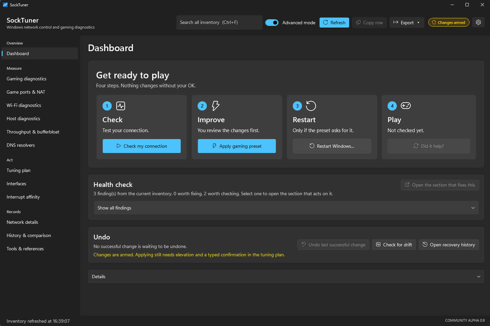
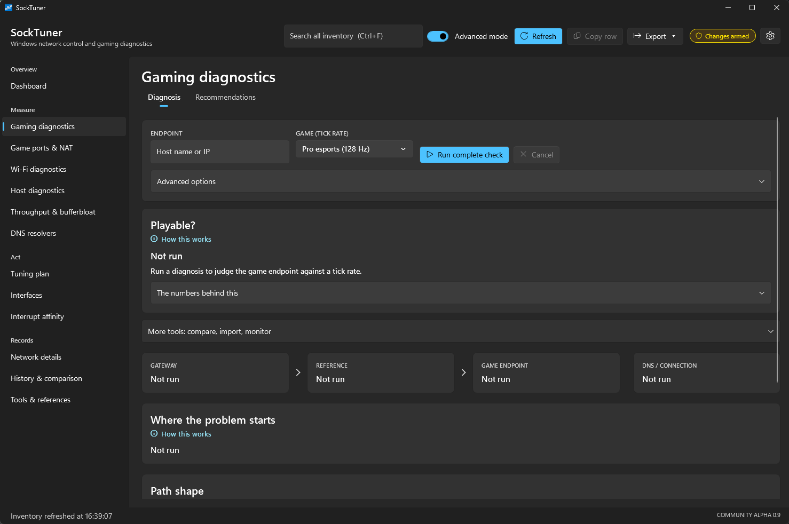
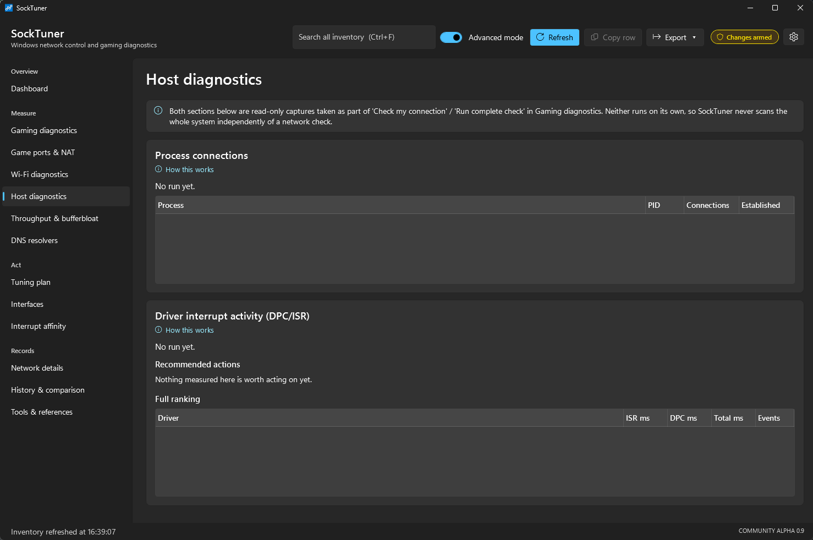
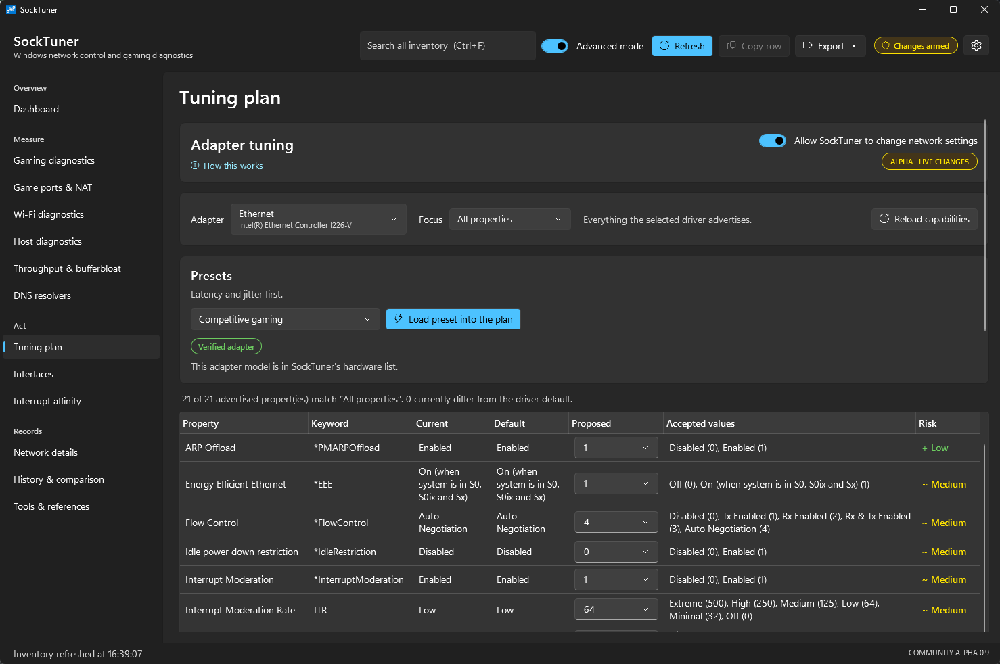
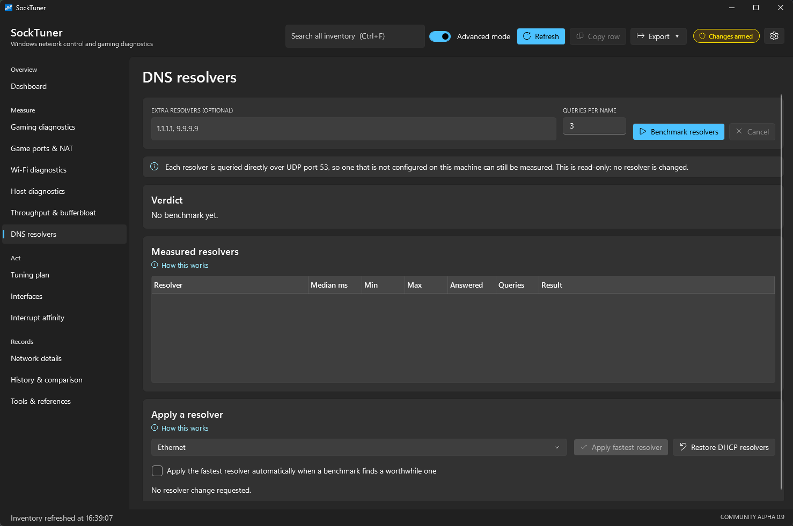
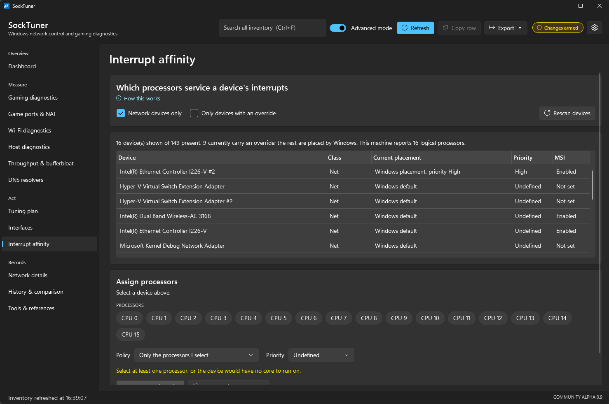
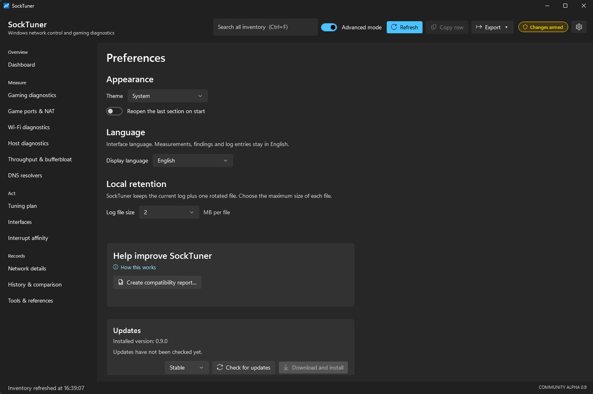

<p align="center">
  
</p>

<p align="center">
  <a href="https://github.com/PrimeBuild-pc/SockTuner/commits/main"></a>
  <a href="https://github.com/PrimeBuild-pc/SockTuner/stargazers"></a>
  <a href="https://github.com/PrimeBuild-pc/SockTuner/issues"></a>
</p>

<p align="center">
  <a href="https://github.com/PrimeBuild-pc/SockTuner/actions/workflows/ci.yml"></a>
  <a href="https://github.com/PrimeBuild-pc/SockTuner/releases"></a>
  <a href="https://github.com/PrimeBuild-pc/SockTuner/releases"></a>
  <a href="LICENSE"></a>
  
  
</p>

<p align="center">
  <b>See what your Windows network stack is really doing — then change it safely, or not at all.</b><br>
  Inventory, gaming diagnostics and reversible NIC tuning in one native app.
</p>

<p align="center">
  <a href="#gallery">Gallery</a> ·
  <a href="#features">Features</a> ·
  <a href="#how-a-change-is-applied">Safety</a> ·
  <a href="#getting-started">Getting started</a> ·
  <a href="#help-improve-hardware-compatibility">Compatibility reports</a> ·
  <a href="#building-from-source">Build</a>
</p>

> [!WARNING]
> **SockTuner is a community alpha, not production software.** Read-only inventory and diagnostics are
> the main surface. Tuning is experimental and changes live network settings: applying a NIC property
> restarts that adapter and briefly drops its link, so never apply a change through the connection
> being changed. Every write needs consent and elevation, and is snapshotted, verified, audited and
> reversible.

## Gallery

<table>
  <tr>
    <td width="50%"><a href="docs/assets/screenshots/dashboard-20261030.png"></a></td>
    <td width="50%"><a href="docs/assets/screenshots/gaming-diagnostics-20261030.png"></a></td>
  </tr>
  <tr>
    <td align="center"><b>Dashboard</b> — inventory at a glance and a health check that opens the section that fixes each finding</td>
    <td align="center"><b>Gaming diagnostics</b> — judge an endpoint against your game's tick rate, then re-run to see if a change helped</td>
  </tr>
  <tr>
    <td><a href="docs/assets/screenshots/host-diagnostics-20261030.png"></a></td>
    <td><a href="docs/assets/screenshots/tuning-plan-20261030.png"></a></td>
  </tr>
  <tr>
    <td align="center"><b>Host diagnostics</b> — which process owns each TCP connection, plus opt-in DPC/ISR culprit detection with one-click fixes</td>
    <td align="center"><b>Tuning plan</b> — only what the driver advertises, with current, default, accepted values and risk</td>
  </tr>
  <tr>
    <td><a href="docs/assets/screenshots/dns-resolvers-20261030.png"></a></td>
    <td><a href="docs/assets/screenshots/interrupt-affinity-20261030.png"></a></td>
  </tr>
  <tr>
    <td align="center"><b>DNS resolvers</b> — benchmark any resolver over UDP 53, then apply or restore DHCP</td>
    <td align="center"><b>Interrupt affinity</b> — which CPUs service each device's interrupts, and MSI state</td>
  </tr>
  <tr>
    <td colspan="2"><a href="docs/assets/screenshots/preferences-20261030.png"></a></td>
  </tr>
  <tr>
    <td colspan="2" align="center"><b>Preferences</b> — appearance, language, local log retention and update channel</td>
  </tr>
</table>

<sub>Captured on 2026-10-30 from a Release build of <a href="https://github.com/PrimeBuild-pc/SockTuner/commit/2306d007376e05cddeb3db7dbc3faa33db236967">main at 2306d00</a>, including the five dependency updates. Diagnostics are shown before a run; no live settings were changed.</sub>

## Who it is for

Tweakers, technicians, competitive players, system integrators and power users who want one place to
inspect and control the Windows networking stack, network adapters and NIC driver settings.

It is not a "make my ping lower" button. Network settings depend on the workload, driver, OS and
topology: disabling RSS, ECN, auto-tuning, offloads or interrupt moderation is not universally
better, Nagle changes only affect TCP while most games use UDP, and no client-side setting replaces
router-side SQM for bufferbloat. SockTuner shows the evidence and the trade-off, and leaves the call
to you.

## Features

| Area | What you get |
| --- | --- |
| **Inventory** | Adapters, routes, interfaces, DNS, network profiles, bindings, NIC counters, TCP templates and globals, QoS policies, offloads, interrupts, Winsock catalog, driver identity and every driver-advertised NDIS property — read natively, no third-party tools |
| **Gaming diagnostics** | One check walks the path layer by layer (PC/NIC, LAN or Wi-Fi, router, access link, ISP, route, server) with latency, loss and jitter percentiles, DNS and TCP timing, path MTU, route quality and a playability verdict against the game's tick rate |
| **Game ports & NAT** | Opt-in IPv4 UDP observations on a chosen local port, game/platform port references, controlled alternate-port checks and security-ranked guidance — no misleading universal Open/Strict grade or automatic router changes. [Method and limits](docs/NAT-DIAGNOSTICS.md) |
| **Wi-Fi diagnostics** | Passive WLAN data from the Windows cache — signal, rate, band, nearby channel pressure — without triggering a scan |
| **Host diagnostics** | Rides the same gaming check: which process owns each TCP connection, and (opt-in, needs admin) which driver's ISR/DPC time correlates with the jitter just measured, with topology-aware interrupt-affinity pinning, outdated-driver-duplicate removal and non-NIC device disable as one-click, reversible actions — never a system-wide scanner |
| **Throughput & bufferbloat** | Opt-in loaded-latency and throughput tests graded on the Waveform scale; external Waveform results can be imported and graded by the same code |
| **DNS resolvers** | Benchmark configured and extra resolvers, apply the fastest one or restore DHCP |
| **Recommendations** | Ranked, evidence-based suggestions sent to the tuning plan, plus router guidance where the fix is not on the PC |
| **Tuning** | Driver-advertised NIC properties, interface state and power, QoS policies and interrupt affinity, all through one allowlisted, reversible write path |
| **Records** | Versioned reports, local history, before/after comparison, trends, drift checks, continuous monitoring with a watchdog, and redacted exports |
| **Languages** | English, Español, Русский, 简体中文 |

## How a change is applied

1. **Pick** an adapter and a focus preset. Only driver-advertised properties are listed, each with its
   current value, driver default, accepted values, risk level and trade-off.
2. **Preview** builds a dry run through a read-only store: current versus proposed, what rollback would
   restore, and the restart requirement.
3. **Apply** asks for the one-time alpha consent, then elevates. High-risk or experimental changes need
   `APPLY` typed to confirm, and so does any change made over a remote session.
4. The **elevated worker** re-reads the driver, refuses anything it no longer advertises or that drifted
   since the preview, writes, reads the value back, records an audit entry, then restarts the adapter
   and checks it returns to its previous link state.
5. **Undo** any audit entry to exactly the values it captured.

SockTuner never invents a value or a range, and any keyword it has not characterised on real hardware
is treated as high risk.

## Getting started

**Requirements:** Windows 10 22H2 or a supported Windows 11 release, x64. The release is a single
self-contained executable: nothing to install, no .NET runtime needed.

1. Download the latest `SockTuner-<version>-win-x64.zip` from
   [Releases](https://github.com/PrimeBuild-pc/SockTuner/releases) and extract it.
2. Alpha builds are not code-signed yet, so SmartScreen will warn on first launch. Check the archive
   against the `.sha256` file published next to it before running it.
3. Start `SockTuner.exe` as a normal user. It only reads until you accept the live-changes notice
   (shown at the first write, or from **Preferences → Live network changes**); each write then asks
   for elevation on its own.

**Updates:** **Dashboard → Updates** checks the stable or preview channel on GitHub Releases. Automatic
installation verifies the SHA-256 checksum and requires both the installed app and the update to be
signed by the same publisher, so it becomes available once releases are signed.

## Help improve hardware compatibility

SockTuner exposes only settings the installed NIC driver actually advertises, so it needs reports from
real hardware — especially **Intel I219/I225/I226**, **Realtek RTL8111/RTL8125**, **Killer/Qualcomm**,
**Broadcom** and **Marvell** adapters, and any machine on **Windows 10**.

1. Refresh the inventory, then open **Preferences → Help improve SockTuner**.
2. Choose **Create compatibility report**, review the plain-text JSON, and let SockTuner open the
   GitHub issue form.
3. Attach the JSON file to the issue.

The report contains the adapter model, driver version, OS version, and driver-advertised keywords and
constraints. It excludes current setting values, persistent adapter and PnP identifiers, MAC and IP
addresses, routes, DNS servers, INF and user paths, machine name and exact timestamps. Creating it is
read-only. The [capability archive](alpha-tester-output/INDEX.md) lists the hardware covered so far.

### Hardware covered so far

SockTuner shows **Verified adapter** next to an adapter whose model is in this list, and **Adapter not verified**
for any other physical adapter; for those, presets are generic and only touch what the driver advertises.
Verified means the driver's properties were captured on real hardware and characterised — not that every
setting helps. The list is regenerated from the [capability archive](alpha-tester-output/INDEX.md).

| Vendor | Adapter | Driver versions seen |
| --- | --- | --- |
| ASIX | AX88179 USB 3.0 Gigabit Ethernet | 1.18.19.1128 |
| Intel | Ethernet Controller I226-V | 2.1.5.7 |
| Intel | Dual Band Wireless-AC 3168 | 19.51.38.2 |
| MediaTek | Wi-Fi 6E MT7922 (RZ616) | 3.6.0.1425 |
| MediaTek | Wi-Fi 7 MT7925 | 5.7.0.4669 |
| Realtek | PCIe 2.5GbE Family Controller (RTL8125) | 10.79.50.1003, 1125.20.729.2024, 1125.21.903.2024, 1125.27.50.919, 1125.31.50.603 |
| Realtek | Gaming 2.5GbE Family Controller | 1125.20.729.2024, 1125.28.20.1224 |
| Realtek | 8852BE Wi-Fi 6 | 6001.15.157.0 |
| Realtek | 8852CE Wi-Fi 6E | 6001.16.172.0 |
| Realtek | 8922AE Wi-Fi 7 | 6102.24.146.0 |

Still missing: Intel I219 and I225, Realtek RTL8111, Killer/Qualcomm, Broadcom, Marvell, other Intel Wi-Fi
generations, and Windows 10. If your adapter says "not verified", use **Report this adapter…** in the Tuning plan.

## Building from source

Requires the [.NET 10 SDK](https://dotnet.microsoft.com/download/dotnet/10.0) on Windows.

```powershell
git clone https://github.com/PrimeBuild-pc/SockTuner.git
cd SockTuner
dotnet build SockTuner.sln
dotnet test SockTuner.sln
dotnet run --project src/SockTuner
```

Built with C#, WPF and the Fluent theme: a mature, native toolkit for a Windows-only administrative
tool, with no browser runtime. Read the [architecture](docs/ARCHITECTURE.md) for how inventory,
diagnostics and the write path fit together.

## License

[MIT](LICENSE). Compatibility reports and bug reports are welcome through the GitHub issue forms; see
[SECURITY.md](SECURITY.md) for reporting vulnerabilities.
